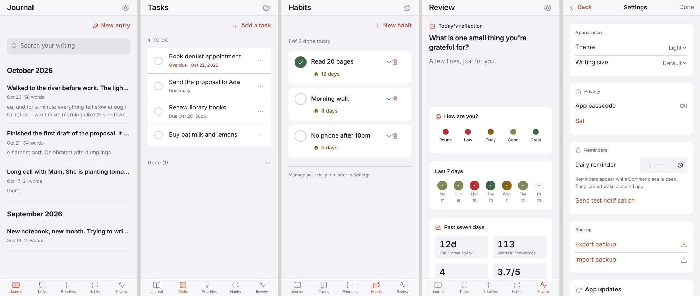
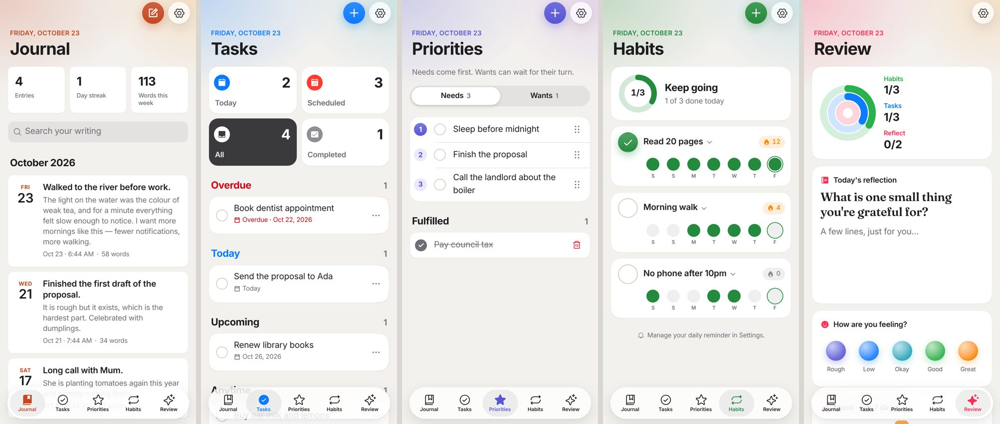
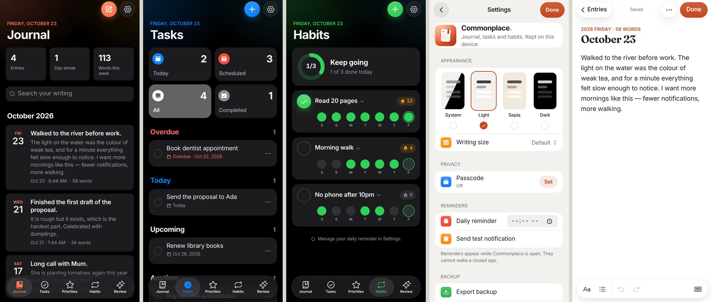
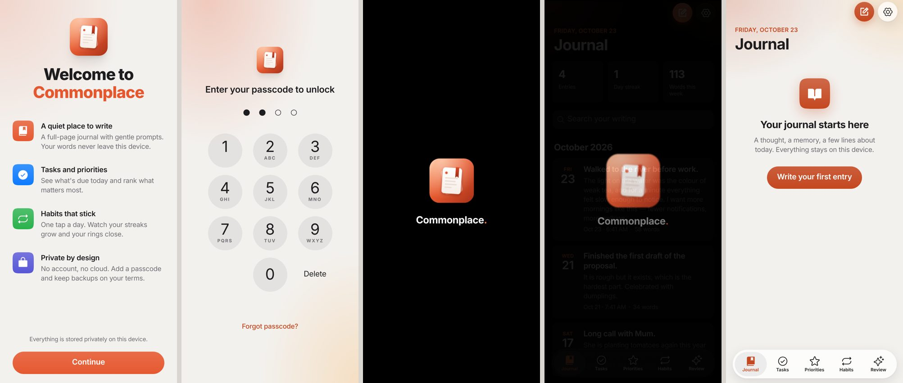
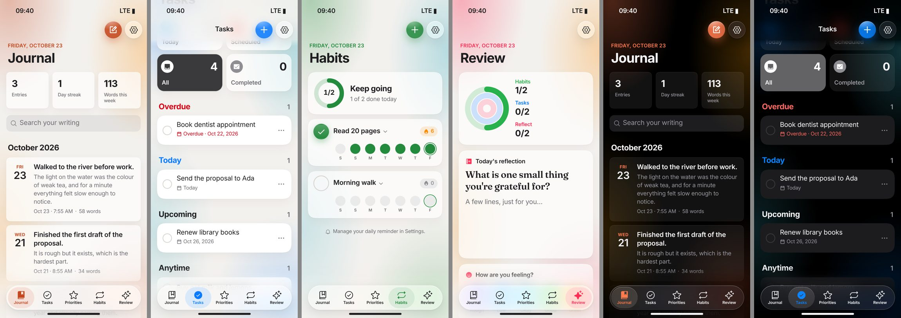
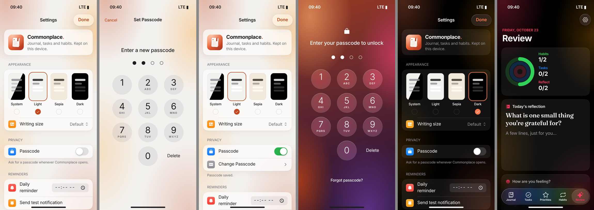

# Redesign (0.3.0)

Captured on a 393×852 viewport (iPhone 15/16 size) in Chromium with sample data.

| | |
|---|---|
| Before |  |
| After — light, one tint per space |  |
| After — dark, settings, writer |  |
| Welcome, lock screen, splash, empty state |  |
| 0.3.1 glass: wallpaper, frosted cards, liquid-glass bars (simulated iPhone, 50pt status bar, 34pt home indicator) |  |
| 0.3.1 Settings, Set Passcode, passcode switch, lock screen, dark |  |
