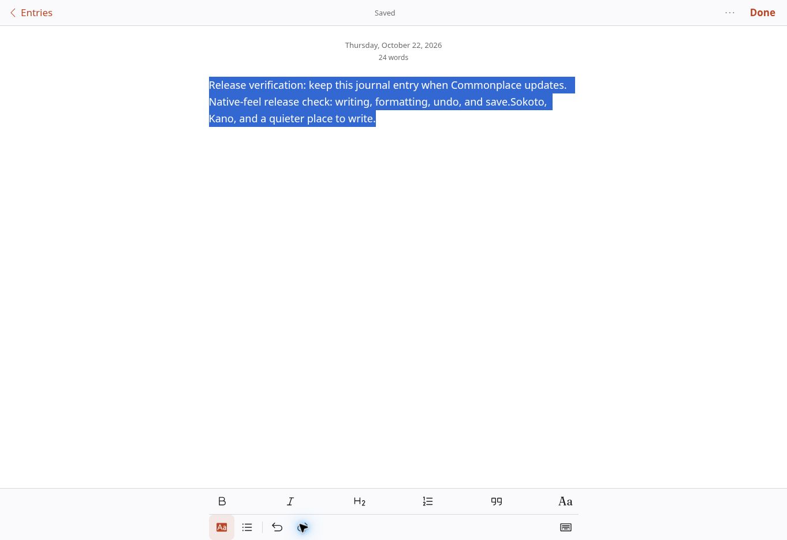
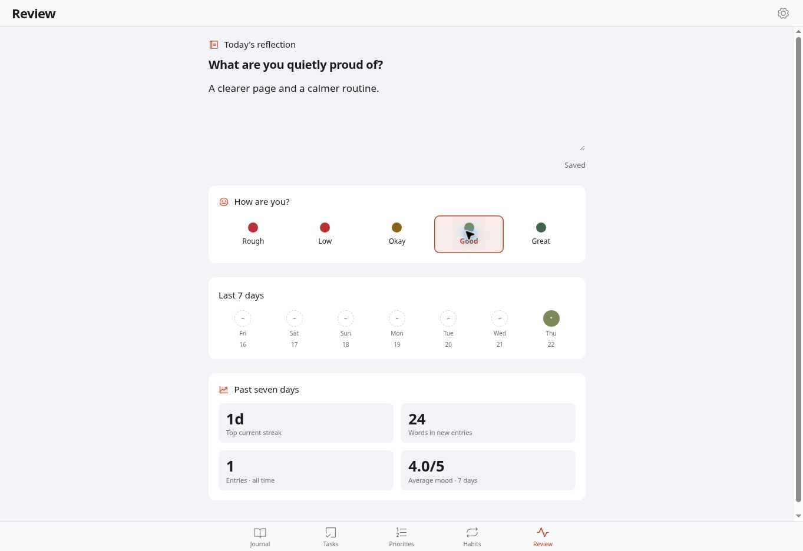

# Redesign verification — 22 October 2026

The user supplied four iPhone screenshots showing a shrunken writer, uncovered sheet backdrop, elevated navigation, and inconsistent visual hierarchy. The redesign was merged through PR #2. Follow-up changes repair worker activation, suppress a false empty-journal flash while IndexedDB loads, and bound rendered list excerpts so long entries do not flood the accessibility tree.

## Automated checks

59 regression tests cover storage migrations and backups, privacy/PIN, ordered autosave and error recovery, editing, daily reminders, keyboard geometry, pinch-versus-keyboard separation, 20 simulated keyboard cycles, drag cancellation, sheet drafts, toolbar semantics, and explicit worker-controller activation. Production build and startup bundle checks pass. See GitHub Actions for checks on the release commit.

## Browser checks actually performed

Public production app, desktop Chrome, 1363 × 936 CSS pixels. These are not physical iPhone results.

- Existing journal entry retained when moving from the old build to the redesign.
- Full-width writer and backdrop: app/backdrop rectangle (0, 0, 1363, 936), no horizontal document overflow.
- Typing, selection-preserving bold, undo/redo, autosave, and Done navigation.
- A 5,000-word entry at the Large writing size: 21px text, editor scroll height 16,941px, visible height 846px, zero horizontal overflow; saved through Done.
- Task form: date field fits inside the panel; primary action stays in the header. Pointer drag dismisses the panel, and reopening restores unfinished task text. Native date-picker completion on iPhone is not verified.
- Task and priority creation; habit completion; reflection autosave and labelled mood selection.
- Theme and writing-size preferences apply through Settings.
- The old update implementation downloaded a worker but did not reliably refresh. The replacement registers natively, saves drafts, waits for controllerchange, and reloads only after an explicit installation. Regression coverage includes activation from another tab.

The protected preview required an access link that automatic approval review rejected. Protection settings were not changed. Browser checks used the existing public production application after the authorized release.

## Still requires physical iPhone testing

Installed standalone app and Safari; portrait and landscape; safe-area geometry; input-focus, double-tap and pinch behavior; actual keyboard opening/closing and caret visibility; dictation, selection handles and IME; date picker; touch pull dismissal and cancellation; VoiceOver, larger system text, background locking and offline relaunch. Desktop automation does not certify these behaviors.

## Evidence

The screenshots show the live application with synthetic test data, not mockups. Both were captured in desktop Chrome. They demonstrate the design and available flow checks, not an iPhone keyboard pass.

